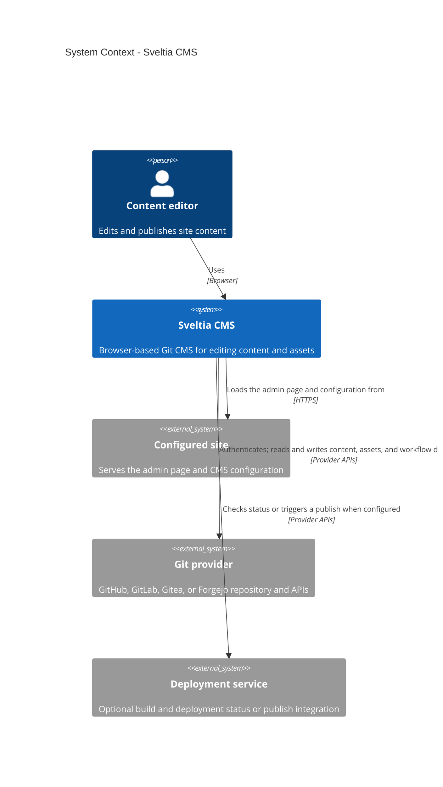
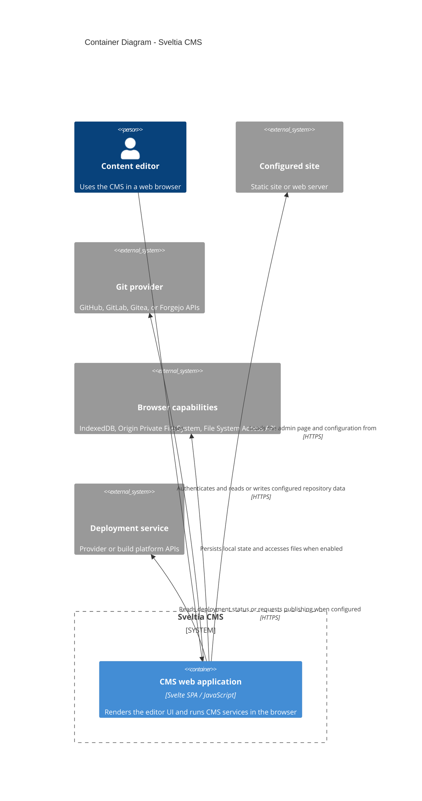
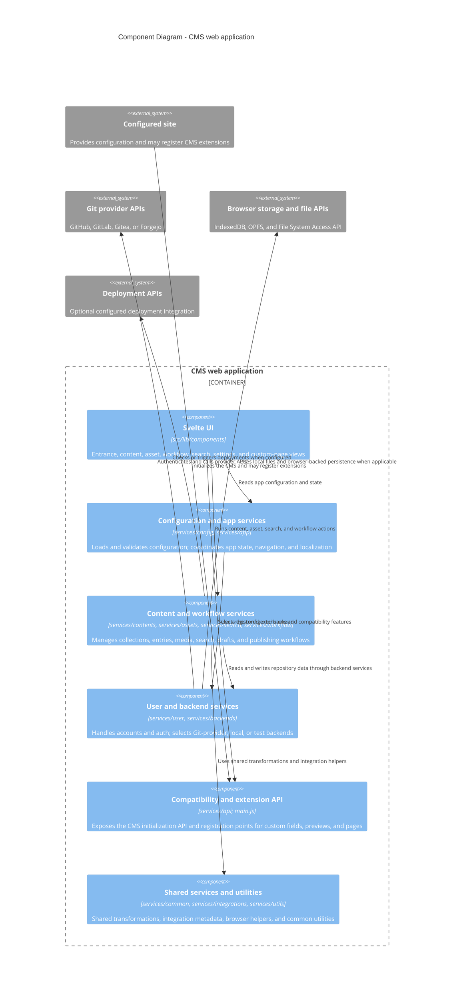

# Architecture

Sveltia CMS is a browser-based, single-page application. Its UI and business logic run in the
browser; it loads site configuration and accesses content through the backend selected in that
configuration. The diagrams below describe the current implementation, not a required deployment
topology.

## C4 level 1: System context

The configured site and content repository may be the same project or separate projects. Deployment
integrations are optional and depend on the configured provider and workflow.

## C4 level 2: Container

The published CMS bundle is static; there is no Sveltia CMS application server in the content
editing request path. In local-backend mode, browser file APIs provide the local working copy, with
a configured Git provider used for the remote repository operations.

## C4 level 3: Components

## Source map

| Area | Entry points |
| --- | --- |
| Browser bundle and public API | `src/lib/main.js`, `src/lib/services/api/` |
| Svelte application and pages | `src/lib/components/` |
| Configuration and app lifecycle | `src/lib/services/config/`, `src/lib/services/app/` |
| Content, media, search, and workflows | `src/lib/services/contents/`, `assets/`, `search/`, `workflow/` |
| Authentication and provider backends | `src/lib/services/user/`, `src/lib/services/backends/` |
| Deployment integrations and shared helpers | `src/lib/services/deployments/`, `integrations/`, `common/`, `utils/` |
| Localization and shared types | `src/lib/locales/`, `src/lib/types/` |
